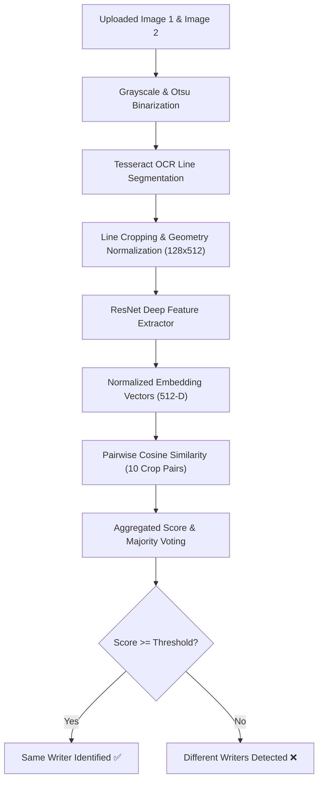

# ✍️ Handwriting Writer Verification System

A deep-learning-powered web application that verifies whether two handwritten documents were authored by the same individual (writer identification / verification).

The system uses a custom **ResNet backbone trained with ArcFace loss**, combined with **Otsu threshold binarization** and **Tesseract OCR line segmentation**, to extract handwriting line crops, generate deep biometric style embeddings, and evaluate pairwise cosine similarity.

---

## 🌟 Key Features

- **Deep Biometric Embeddings**: Uses a ResNet backbone with ArcFace feature representations to extract writer-specific handwriting style representations.
- **Automated Text Line Extraction**: Automatically segments lines of handwriting using Otsu binarization and Tesseract OCR bounding boxes.
- **Multi-Crop Pairwise Comparison**: Evaluates up to 10 crop pairs between both documents, computing cosine similarity and aggregating results via mean score and majority voting.
- **Interactive Web Interface**: Clean, responsive UI with side-by-side document upload, adjustable cosine threshold slider, and real-time verification feedback.
- **Flexible Configuration**: Supports custom model checkpoints, threshold tuning, and custom Tesseract binary paths via environment variables.

---

## 🏗️ Architecture & Pipeline



1. **Preprocessing & Binarization**: Converts input documents to grayscale and applies Otsu thresholding to isolate ink from paper background.
2. **Line Segmentation**: Detects text regions using Tesseract OCR bounding boxes. If OCR is not available or detects no lines, the system gracefully falls back to using the full binarized image.
3. **Normalization**: Resizes crops to height 128, proportionally pads/scales width to 512, and normalizes pixel values.
4. **Feature Extraction**: Passes line crops through the deep ResNet feature extractor and batch normalization layer to produce 512-dimensional normalized embeddings.
5. **Pairwise Comparison**: Computes dot products (cosine similarities) across 10 deterministic crop pairs between Document A and Document B.
6. **Decision**: Computes the mean similarity score and counts votes against the decision threshold.

---

## 📁 Project Structure

```
handwritingClassification/
├── app.py                 # Flask server, model definition, preprocessing & inference logic
├── templates/
│   └── index.html         # Frontend UI for uploading samples & viewing verification results
├── requirements.txt       # Python package dependencies
├── .gitignore             # Git ignore file (excludes model checkpoints, cache, temp files)
└── README.md              # Project documentation
```

---

## ⚙️ Prerequisites

1. **Python 3.8+**
2. **Tesseract OCR**:
   - **Windows**: Download and install from [UB-Mannheim Tesseract Releases](https://github.com/UB-Mannheim/tesseract/wiki).
   - **Ubuntu/Debian**:
     ```bash
     sudo apt-get update && sudo apt-get install -y tesseract-ocr
     ```
   - **macOS**:
     ```bash
     brew install tesseract
     ```

---

## 🚀 Installation & Quickstart

### 1. Clone the Repository
```bash
git clone https://github.com/<YOUR-USERNAME>/handwritingClassification.git
cd handwritingClassification
```

### 2. Create and Activate a Virtual Environment
- **Windows (PowerShell)**:
  ```powershell
  python -m venv venv
  .\venv\Scripts\Activate.ps1
  ```
- **Linux / macOS**:
  ```bash
  python3 -m venv venv
  source venv/bin/activate
  ```

### 3. Install Dependencies
```bash
pip install -r requirements.txt
```

### 4. Download Model Weights
Place your trained checkpoint `best_verifier.pt` into the root directory of the project.
> 💡 *If you uploaded the weights to the **GitHub Releases** page, download `best_verifier.pt` from the latest release and place it in the project root.*

### 5. Run the Application
```bash
python app.py
```
Open your web browser and navigate to:
```
http://127.0.0.1:5000
```

---

## 🔧 Environment Variables

You can configure application behavior using environment variables:

| Variable | Description | Default |
|---|---|---|
| `MODEL_PATH` | Path to the PyTorch checkpoint (`.pt` file) | `best_verifier.pt` |
| `THRESHOLD` | Override the default cosine similarity threshold | Loaded from checkpoint (or `0.5`) |
| `TESSERACT_CMD` | Explicit path to the Tesseract binary (useful on Windows) | Uses system `PATH` |

#### Example on Windows PowerShell:
```powershell
$env:TESSERACT_CMD = "C:\Program Files\Tesseract-OCR\tesseract.exe"
$env:MODEL_PATH = "best_verifier.pt"
python app.py
```

---

## 🔌 API Reference

### `POST /compare`
Compares two handwriting samples.

- **Content-Type**: `multipart/form-data`
- **Parameters**:
  - `image1` (file, required): First handwriting image file.
  - `image2` (file, required): Second handwriting image file.
  - `threshold` (float, optional): Custom similarity threshold.

**Sample Response (`application/json`)**:
```json
{
  "lines_found": [6, 8],
  "mean_score": 0.742,
  "same_writer": true,
  "scores": [0.78, 0.71, 0.75, 0.73, 0.79, 0.69, 0.74, 0.72, 0.76, 0.75],
  "threshold": 0.65,
  "votes_same": 10,
  "votes_total": 10
}
```

---

## 🛡️ License

This project is licensed under the [MIT License](LICENSE) (or choose your preferred license).
